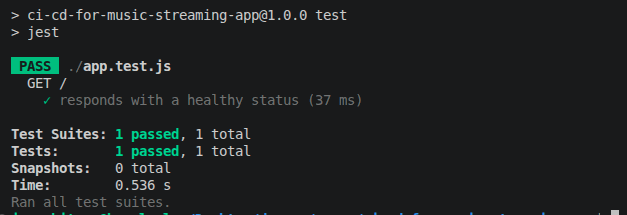

# CI-CD for Music Streaming App

### Objective
- To build automated CI-CD pipeline for nodejs application.

### Tech Stack
- Github
- Github Action
- Docker
- Fly.io

### To run the server
#### Run 'node server.js' and visit http://localhost:3000

### To test the server
#### Run 'npm test'

### Containerize the application
#### Build the container
- docker build -t nodejs-cicd .
#### Run the container
- docker run -p 3000:3000 nodejs-cicd

### Setup Fly.io for Deployment (macOS/Linux)
####
- curl -L https://fly.io/install.sh | sh

#### login to fly.io
- flyctl auth login

#### launch
- flyctl launch --no-deploy 

#### create deployment token and add to the repo secret
- flyctl tokens create deploy

- push all codes the github

#### Reference - https://medium.com/@devopslesson/build-a-full-ci-cd-pipeline-for-a-node-js-app-from-zero-to-auto-deploy-in-one-hour-fc5a387ec75c